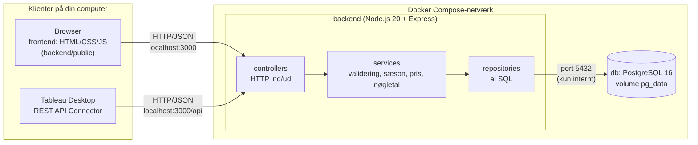

# Hotel Kong Arthur – bookinger, nøgletal og barsalg

Et system til Hotel Kong Arthur i København (3. semester, gruppeprojekt):

- **Receptionen** opretter, finder, retter og afbestiller bookinger på hotellets 214 værelser.
  Sæson og pris udregnes automatisk ud fra ankomstdato, værelsestype og antal nætter.
- **Administrationen** ser indtjening pr. land, værelsestype og sæson, belægning pr. nat og de
  mest solgte drinks, både i browseren og i Tableau.
- **Baren** (Helene Christine) registrerer salg af kaffe og cocktails og ser barens omsætning.

Alle tal beregnes af et REST API ud fra databasen ved hvert kald. Browseren og Tableau læser de
samme endpoints, så tallene er ens overalt. Startdata er de 1000 bookinger og 30 drikkevarer fra
[ITAKEA/hoteldata](https://github.com/ITAKEA/hoteldata).

## Arkitektur



- **Tre lag** (konstitution II): controllers kalder kun services, services kun repositories. SQL
  findes kun i `repositories/`, beregninger kun i `services/`.
- **Én vej til data** (konstitution IV): browser og Tableau bruger kun API'et. Databasen har ingen
  port på værten.
- **Porte**: `backend` på `3000` (udstillet på værten), `db` på `5432` (kun i Compose-netværket).
- **Dev-container** `app` (Spec Kit + Claude Code) ligger bag profilen `dev` og starter ikke med
  systemet.

## Kom i gang

Kræver Docker Desktop (Compose v2.20+). Node er ikke nødvendig, fordi alt kører i containere.

```bash
cp .env.example .env            # udfyld egne passwords (brug ikke de gamle fra Git-historikken)
docker compose up --build       # starter db (PostgreSQL) og backend
```

Første gang, og når du vil tilbage til startdata:

```bash
docker compose down -v          # sletter volumen pg_data: alle nye bookinger og barsalg forsvinder
docker compose up --build       # db-init/ indlæser skema og startdata igen
```

`backend` starter først, når databasen er *healthy*. Efter ændringer i `backend/` (også
`backend/public/`) genbygges med `docker compose up -d --build backend` og Ctrl + F5 i browseren.

| Adresse | Indhold |
|---------|---------|
| http://localhost:3000/ | Forside med links til de tre sider |
| http://localhost:3000/bookings.html | Bookinger: opret, søg, ret og slet |
| http://localhost:3000/overview.html | Overblik: indtjening, belægning og mest solgte drinks |
| http://localhost:3000/bar.html | Baren: registrér og slet salg, barens nøgletal |
| http://localhost:3000/api-docs | Swagger UI: alle 21 endpoints, kan afprøves direkte |
| http://localhost:3000/api/health | `{"status":"ok"}`, når API og database kører |

### Tests

```bash
cd backend && npm test                              # 55 unit-tests (Node 20+ lokalt)
docker compose run --rm --no-deps backend npm test  # eller i containeren
```

Testene dækker de rene funktioner i forretningslaget (sæson, pris, validering og nøgletal) og
kræver ingen database. Hele systemet afprøves med [quickstart](specs/001-booking-kpi-bar/quickstart.md).

### Databasen

```bash
docker compose exec db sh -c 'psql -U "$POSTGRES_USER" -d "$POSTGRES_DB"'
```

Skema og startdata ligger i [`db-init/`](db-init/README.md). `02-seed.sql` er genereret af
`scripts/generate-seed.js` ud fra kildefilerne i `scripts/source/`.

### Dev-container (valgfri)

```bash
docker compose --profile dev up -d app
docker compose exec app bash        # Spec Kit (specify) og Claude Code er installeret
```

## API

Hele kontrakten står i [`openapi.yaml`](specs/001-booking-kpi-bar/contracts/openapi.yaml) og kan
afprøves i Swagger UI.

| Område | Endpoints |
|--------|-----------|
| Bookinger | `GET/POST /api/bookings` (`?search=`), `GET/PUT/DELETE /api/bookings/{id}` |
| Nøgletal | `GET /api/kpi/revenue/total`, `…/by-country`, `…/by-room-type`, `…/by-season`, `…/by-room-type-season`, `GET /api/kpi/occupancy?date=`, `…/occupancy/nights`, `GET /api/kpi/top-drinks` |
| Bar | `GET /api/bar/drinks`, `GET/POST /api/bar/sales`, `DELETE /api/bar/sales/{id}`, `GET /api/bar/kpi/total`, `…/revenue-by-drink`, `…/category-split` |
| Drift | `GET /api/health` |

Historiske bookinger fra datafilen kan ikke rettes eller slettes (`409`). Fejl returneres som JSON
med en forståelig besked og de berørte felter, fx
`{"error": "...", "fields": ["arrival_date", "nights"]}`.

## Tableau

Tableau Desktop (2023.3+) henter nøgletallene som JSON direkte fra API'et med **REST API
Connector** fra Tableau Exchange. Der er ingen CSV-eksport og ingen direkte databaseforbindelse.

1. *Connect → REST API Connector*, metode GET, URL `http://localhost:3000/api/...`.
2. JSONPath `$` for endpoints, der svarer med ét objekt (fx `kpi/revenue/total`), og `$[*]` for
   lister (fx `kpi/revenue/by-country`).
3. Nye bookinger og salg vises efter *Data → Refresh*.

Alle datakilder og de forventede tal står i [quickstart trin 7](specs/001-booking-kpi-bar/quickstart.md#7-tableau-desktop-fr-021-fr-027-sc-007).

## Projektstruktur

```text
backend/            Express-app: src/ (controllers, services, repositories), public/ (frontend), tests/
db-init/            01-schema.sql og 02-seed.sql til PostgreSQL (køres ved tom volumen)
scripts/            generate-seed.js og kildefilerne fra ITAKEA/hoteldata
styleguide/         Hotellets visuelle retningslinjer og skærmbilleder (frontend-design)
specs/001-…/        Spec Kit: spec, plan, research, datamodel, kontrakt, tasks, quickstart, converge
docker/             Dev-containeren (profil "dev")
compose.yaml        db + backend
```

## Udvikling og dokumentation

Projektet er lavet med [Spec Kit](https://github.com/github/spec-kit): spec → plan → tasks → kode.
Reglerne står i [konstitutionen](.specify/memory/constitution.md).

- [Specifikation](specs/001-booking-kpi-bar/spec.md): user stories, krav og succeskriterier
- [Plan](specs/001-booking-kpi-bar/plan.md) og [research](specs/001-booking-kpi-bar/research.md): tekniske valg og begrundelser
- [Tasks](specs/001-booking-kpi-bar/tasks.md): alle opgaver og deres status
- [Converge](specs/001-booking-kpi-bar/converge.md): hvad er implementeret, og hvad mangler
- [Quickstart](specs/001-booking-kpi-bar/quickstart.md): afprøvning af hele systemet med forventede tal

Uge 1-versionen med MySQL er gemt i Git-tagget `uge1-mysql`. Fra uge 2 bruges PostgreSQL efter
hotellets ønske.
